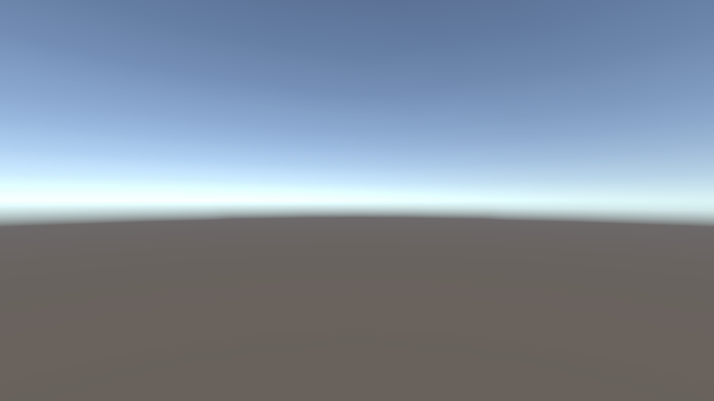

# Forest in Motion

USC CSCI 580 Graphics Final Project

## Overview

We plan to show a gust passing through a small forest beside a creek. The viewer will watch from the bank, then replay the same gust while accelerating along a curved path. Can we still tell which tree bends first, and follow its shadow across the bank, when the camera moves?

## Graphics Techniques

1. **Forest placement (Lecture 12).** We will place two marker trees beside the creek and scatter the surrounding trees using a fixed random seed. Both camera runs will see the same forest.
2. **Wind transport.** We will model a gust as a pulse carried downwind at a constant speed. At 3 m/s, we expect the pulse to peak at a tree 6 m downwind after 2 seconds and at a tree 12 m downwind after 4 seconds. We will compare that timing with a noise-driven wind field. [Linear advection model](https://www.clawpack.org/riemann_book/html/Advection.html)
3. **Vegetation and shadows (Lectures 19 and 08).** We will use an HLSL vertex shader to keep roots fixed, bend the branches and flutter the leaves. The shadow pass will use the same deformed vertices so the branch silhouette moves across the bank.
4. **Camera replay (Lecture 18).** We will reset one clock for each eight-second run. The first camera will hold still. The second will start at the same pose and follow a cubic Bézier curve along the creek.

## Setup and Run

The current checkout opens the Unity starter scene. Install **Unity Editor 6000.3.25f1** through Unity Hub. The project manifest requests **Universal Render Pipeline 17.3.0**, which Unity resolves on first open. [Editor version](ProjectSettings/ProjectVersion.txt) · [Package manifest](Packages/manifest.json)

1. Clone the repository if you need a fresh copy.

   ```powershell
   git clone https://github.com/sunnyb179/580-Group-Project.git
   cd 580-Group-Project
   ```

2. In Unity Hub, choose **Add project from disk** and select the folder containing `Assets`. On Windows with the default Hub install location, you can also launch the editor from that folder in PowerShell.

   ```powershell
   & "$env:ProgramFiles\Unity\Hub\Editor\6000.3.25f1\Editor\Unity.exe" -projectPath .
   ```

3. In the Project window, open `Assets/Scenes/SampleScene.unity` and press **Play**. The forest and replay controls are planned for a later scene.

## Results

**Expected result.** We plan to record one fixed shot and one fly-through. In the fixed shot, the nearer crown should bend first and its shadow should move across the bank. For the replay check, we will pause each run at 2 and 4 seconds and inspect the marked branches and shadows through the same fixed camera. We will add the paired clips and describe what we actually observed once the forest runs.

<details>
<summary>Current starter scene, November 13, 2026</summary>

The main camera shows the starter skybox and horizon.



</details>

## Credits and References

Our team is Qiuyi Chen, Wenting Zhang, Zhehao Cai and Zhongbo Sun. Professor Carter Slocum suggested exploring physically based wind models alongside noise functions.

- Renaldas Zioma describes how a vertex shader can animate trees using a wind field. [GPU Gems 3, Chapter 6](https://developer.nvidia.com/gpugems/gpugems3/part-i-geometry/chapter-6-gpu-generated-procedural-wind-animations-trees)
- We are considering these visual references for the tree canopy and creek surface. [StylizedTrees by mozankatip](https://github.com/mozankatip/StylizedTrees) · [Uber Stylized Water by MatrixRex](https://github.com/MatrixRex/Uber-Stylized-Water)
- Jam2go’s real-time datamoshing demo inspired an optional effect that would stretch fragments of earlier frames during camera acceleration. [Unreal demo](https://www.youtube.com/watch?v=Uapad3pVxBY)
